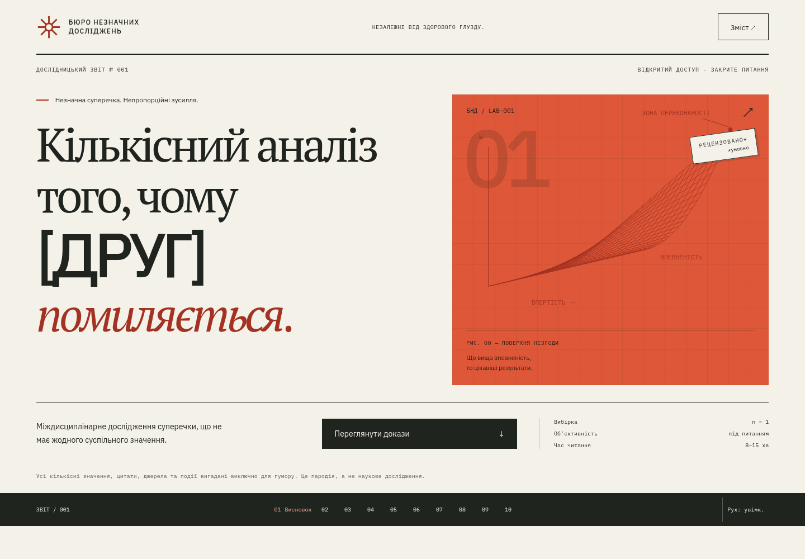

# GSAP edition · Кількісний аналіз того, чому [ДРУГ] помиляється

Інтерактивний український пародійний звіт: **40 експонатів, 10 розділів, 10 000 синтетичних сценаріїв і одна абсолютно неважлива суперечка.**

**[Відкрити сайт](https://guardianec.github.io/unnecessary-research-refined/)** · [Репозиторій](https://github.com/Guardianec/unnecessary-research-refined)



Окрема редакційна GSAP-версія для порівняння з [оригіналом](https://guardianec.github.io/unnecessary-research/). Оригінальний репозиторій залишається без змін.

## Концепція

Жарт — у невідповідності між нульовою важливістю теми та надмірною серйозністю подачі. Теплий папір, редакційна антиква, тонкі лінії й червоні аналітичні позначки утворюють вигадану дослідницьку публікацію. Немає наслідування конкретної установи, реклами, аналітики, облікових записів чи зовнішніх наборів даних.

Шлях читача: висновок → передумови → спостереження → статистика → симуляція → стратегія → механізм → жива модель → рецензування → вердикт. Орієнтовний час із взаємодіями — 8–15 хвилин.

## Локальний запуск

Потрібні Node.js 22.13+ (або новіший LTS), npm і Git. Chrome потрібен лише для браузерних тестів та генерації OG.

```sh
git clone https://github.com/Guardianec/unnecessary-research-refined.git
cd unnecessary-research-refined
npm ci
npm run dev
```

Dev-сервер: `http://127.0.0.1:5173`. З каталогу вже встановленого проєкту точна команда запуску — **`npm run dev`**.

```sh
npm run build
npm run preview
```

Production preview: `http://127.0.0.1:4173`. Статична збірка зберігається в `dist/`.

## Змінити суперечку

Єдине джерело вмісту — **`src/content/report.ts`**.

```ts
friendName: '[ДРУГ]',
disagreement: '[ПРЕДМЕТ СУПЕРЕЧКИ]',
myPosition: '[МОЯ ПОЗИЦІЯ]',
friendPosition: '[ПОЗИЦІЯ ДРУГА]',
finalMessage: 'ТИ ПОМИЛЯЄШСЯ.',
seed: 42,
animationIntensity: 1,
```

Це українські відповідники `[FRIEND]`, `[THE DISAGREEMENT]`, `[MY POSITION]`, `[FRIEND’S POSITION]`. Змінюйте їх на вигадані значення. Вони підставляються в заголовок, позиції, висновки та інтерактивні схеми. `finalMessage` змінює великий остаточний вердикт. Не додавайте чужих особистих даних.

У цьому ж файлі: `exhibits` (тексти 40 експонатів), `chapters` (зміст), `statistics`, `timeline`, `methods`, `risks`, `criteria`, `sliders`, `reviewers`, `citations`, `footnotes` та `ui` (підписи інтерфейсу й розгорнуті заголовки). Знайдіть потрібний український текст у `ui`, щоб відредагувати його; числові ключі стабільні.

Метадані заголовка отримують `friendName` під час збірки. Після зміни імені перегенеруйте картинку для соцмереж: запустіть production preview, а в іншому терміналі — `npx tsx scripts/create-og.ts`. Потім повторіть `npm run build`. Якщо форкаєте репозиторій, також змініть абсолютний `og:image` у `index.html` на URL вашого Pages.

## Фальшиві дані та графіки

`src/lib/fakeData.ts` містить детермінований LCG-генератор, набір із 120 спостережень, симуляцію, обчислення зважених оцінок та живу модель. `seed` у конфігурації контролює відтворюваність. Симуляція реально генерує 10 000 булевих результатів; показаний відсоток обчислюється з них, а не підміняється готовим числом. Тому він може трохи відрізнятися від параметра 93,7%. Заява про 4,1% втомлених дослідників — окрема вигадана ознака, не третя категорія результатів.

Для зміни графіка редагуйте відповідну функцію генерації та його текст у `report.ts`. Для додавання — створіть компонент у `src/Charts.tsx`, використайте його всередині `Exhibit` у `main.tsx` і додайте опис до конфігурації. Передайте SVG доступний заголовок, осі, одиниці й текстовий висновок. Великі масиви малюйте Canvas, а не тисячами DOM-вузлів. Додайте тест відтворюваності, меж і підрахунку результатів.

Матриця рішень дійсно обчислюється з `criteria`. Ваги мають сумуватися до 1; поточні результати — 9,42 та 3,17. Модульний тест контролює узгодженість із `statistics`. Регресія, p-значення, R², довірчі межі й умовна баєсівська оцінка є **написаними автором пародійними ілюстраціями**, а не результатами справжнього оцінювання. Нейромережа — SVG-схема без навченої моделі.

## Рух і доступність

`animationIntensity: 0` вимикає рух за замовчуванням. Значення 0,5–2 змінюють тривалість появи графіків (більше значення — швидше). Кнопка «Рух» дозволяє вимкнути його в сеансі. Налаштування ОС `prefers-reduced-motion` має пріоритет. Симуляція тоді одразу малює всі результати. Безкінечних декоративних анімацій немає.

SVG-лінії відкриваються зліва направо; довірчий інтервал стискається до оцінки; сигнали нейромережі проходять один цикл. IntersectionObserver запускає рух лише в полі зору. KaTeX завантажується поблизу формул, не на титульному екрані.

Є семантичні landmarks, послідовні заголовки, skip-link, видимий focus, native range inputs і details, текстові альтернативи графіків, навігація Tab та Alt+↑/↓. Карта ризиків і граф аргументів працюють кліком, дотиком і клавіатурою. Escape закриває зміст та повертає фокус. Мобільна горизонтальна прокрутка обмежена складною нейромережею; вся сторінка не прокручується горизонтально.

## Технології та структура

React + TypeScript + Vite, власні CSS/SVG/Canvas, KaTeX. Локальні шрифти: PT Serif, IBM Plex Sans і IBM Plex Mono з кирилицею. GSAP + ScrollTrigger керують появою титулу, кресленням ліній та переходами розділів. Немає UI-фреймворків або бібліотек графіків.

```text
src/content/report.ts        конфігурація, тексти, вигадані джерела
src/lib/fakeData.ts          генерація та обчислення
src/Charts.tsx               SVG, Canvas та інтерактивні моделі
src/main.tsx                 композиція й навігація
src/style.css               токени, типографіка, адаптивність, рух
public/                     favicon та OG-картинка
tests/                      unit + Playwright + axe
scripts/create-og.ts        програмна генерація картинки поширення
scripts/github-pages.py     додатковий адміністративний помічник
.github/workflows/deploy.yml перевірки, збірка та GitHub Pages
docs/                       рішення дизайну й звіт перевірок
```

## Перевірки

```sh
npm run format
npm run format:check
npm run lint
npm run typecheck
npm test
npm run build
npm run test:e2e
```

Playwright використовує встановлений Chrome (`channel: 'chrome'`). Для іншого встановленого Chromium задайте `CHROMIUM_PATH=/шлях/до/chromium`. Знімки, traces і проміжні результати зберігаються в ігнорованому `test-results/`.

Тести проходять усі 10 розділів при 1440×1000, 768×1024 і 390×844, перевіряють інтерактиви, клавіатуру, reduced motion, переповнення, консоль і правила axe WCAG A/AA. Для публічного сайту задайте `PUBLIC_URL=https://guardianec.github.io/unnecessary-research-refined/` перед `npm run test:e2e`; у PowerShell: `$env:PUBLIC_URL='https://guardianec.github.io/unnecessary-research-refined/'; npm run test:e2e`.

## GitHub Pages

Публікація без платних сервісів. У **Settings → Pages → Build and deployment → Source** оберіть **GitHub Actions**. Workflow на кожний push у `main` встановлює залежності через `npm ci`, перевіряє форматування, lint, типи та unit-тести, будує `dist/`, завантажує Pages artifact і розгортає його через `actions/deploy-pages`.

Повторне розгортання: push у `main` або **Actions → Validate and deploy research → Run workflow**. Не потрібні особисті токени в repository secrets: workflow використовує обмежений `GITHUB_TOKEN` та OIDC. Відносна база Vite `./` підтримує адресу `https://<account>.github.io/<repository>/`. Серверного маршрутизатора немає; розділи мають hash-посилання.

`scripts/github-pages.py` — необов’язковий одноразовий помічник для створення репозиторію, налаштування Pages і читання статусу. Він отримує credential від Git Credential Manager лише в пам’ять та не записує й не друкує токен. Звичайне розгортання через Actions його не використовує.

## Політика вигаданих даних

**Не використано реальних розмов, повідомлень, скриншотів, персональних імен, місць, цитат чи приватних даних.** Усі дослідницькі твердження, події, рецензенти, числа та бібліографія вигадані. Відносні позначки T−20 хв / T+2 доби — сюжетні інтервали, не дати реальних подій. Сайт висміює надмірність роботи, а не людину. Код ліцензовано MIT; шрифти зберігають власні відкриті ліцензії пакетів.

## Попередній перегляд редакційного оновлення

```sh
npm run build:preview
```

`preview-dist/index.html` — переносний HTML з вбудованими скриптами та шрифтами. Відкрийте його в браузері для перегляду без публікації. Звичайна production-збірка залишається в `dist/`, з окремим завантаженням KaTeX.

`src/useReportMotion.ts` керує GSAP-анімаціями. Перемикач руху та системний `prefers-reduced-motion` скасовують анімації, прибирають ScrollTrigger і повертають початкові стилі. Прокручування залишається нативним.
